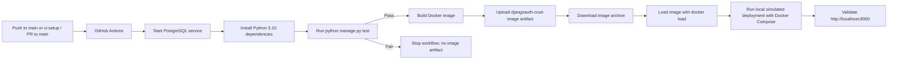

# CI/CD pipeline and simulated deployment

## Flow



## GitHub Actions workflow

The workflow in `.github/workflows/ci.yml` has two dependent jobs:

1. **test** starts a PostgreSQL 15 service, installs `requirements.txt` with Python 3.10, and runs `python manage.py test`. The database URL and secret key are test-only values.
2. **build-image** runs only after tests pass. Docker Buildx builds the project image and exports it as `/tmp/djangoauth-crud.tar`. `actions/upload-artifact` publishes the archive as `djangoauth-crud-image` for 30 days. The image is not pushed to DockerHub or another container registry.

The workflow runs on pushes to `main` and `ci-setup`, pull requests targeting `main`, or manual dispatch from the repository's **Actions** tab.

## Local Docker deployment

To simulate deployment from a separate Windows folder, first publish the `ci-setup` branch to GitHub. Then clone that branch into an external folder and start both services:

```powershell
git clone --branch ci-setup https://github.com/Rdiazr14/DjangoAuth-CRUD.git C:\temp\DjangoAuth-CRUD-deploy
Set-Location C:\temp\DjangoAuth-CRUD-deploy
docker compose up --build
```

The `db` service runs PostgreSQL and persists its data in the `postgres_data` volume. The `web` service waits for the database health check, builds the Django image, applies migrations through `entrypoint.sh`, and serves the application on port 8000. Open `http://localhost:8000` to validate it. Stop the services with `Ctrl+C`; remove the containers and network with `docker compose down`.

For a local run without cloning, run the same `docker compose up --build` command from the project root.

To deploy the workflow artifact instead, download and extract `djangoauth-crud-image` from a successful Actions run, then load the image:

```bash
docker load --input djangoauth-crud.tar
```

The artifact contains the Django image only. It still requires a PostgreSQL database; the Compose setup in the checked-out project provides one for the local simulation.

## Evidence checklist

Capture genuine screenshots after completing these steps; do not use screenshots of a failed or unexecuted run as success evidence.

- [ ] The repository shows the `ci-setup` branch and the committed workflow files.
- [ ] GitHub Actions shows the test job passing, including the Django test result.
- [ ] GitHub Actions shows the `build-image` job passing and the downloadable `djangoauth-crud-image` artifact.
- [ ] Docker Compose shows both `web` and `db` running.
- [ ] A browser displays the application at `http://localhost:8000`.
- [ ] The downloaded image is loaded with `docker load`.

## Recommendations

- Store production `SECRET_KEY` and database credentials as GitHub Actions secrets; never reuse the development values in production.
- Keep tests and image creation as separate jobs so a failed test cannot produce a release artifact.
- Use immutable release tags and a managed container registry for a real deployment; this exercise intentionally simulates deployment without publishing an image.
- Use a production WSGI server, secure `DEBUG`/`ALLOWED_HOSTS` settings, and a managed database before exposing the application publicly.

## Conclusion

This pipeline automates Django tests and builds a Docker image only after the tests pass. GitHub Actions keeps the image as a temporary artifact, while Docker Compose provides a reproducible local deployment with PostgreSQL. This demonstrates continuous integration and a simulated delivery flow without requiring DockerHub.

## Individual conclusions

Add one conclusion from each group member to the final submission after the practical work and evidence have been completed.
